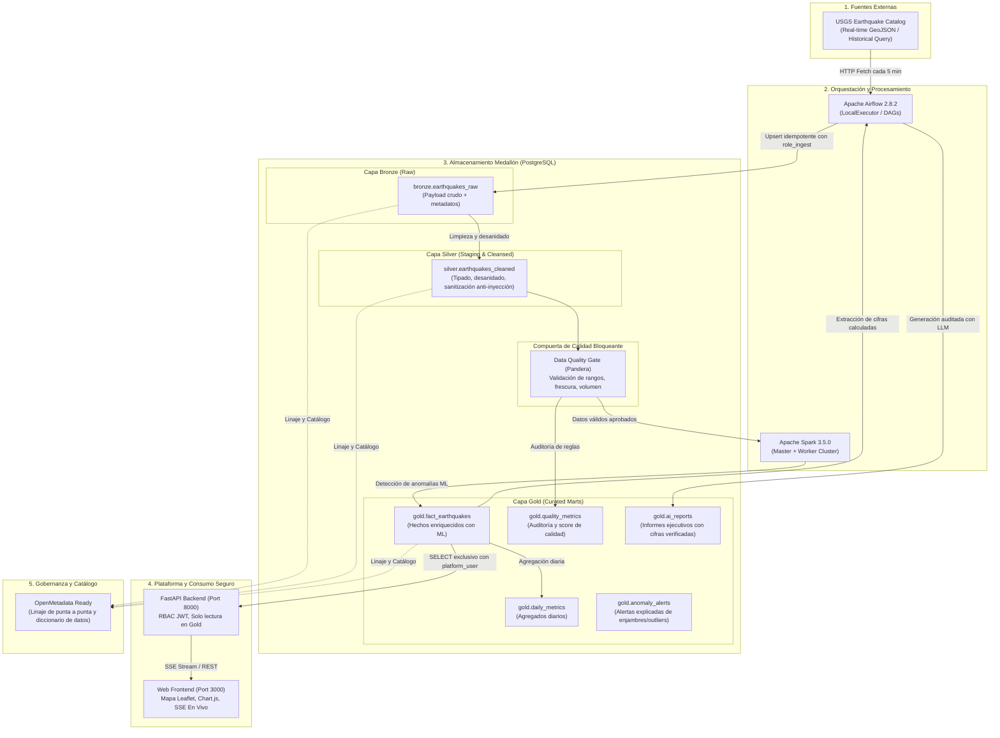

# Arquitectura de Datos y Documento de Diseño Técnico: SismoWatch

## 1. Propósito de la Arquitectura

### 1.1 Problema que Resuelve
SuperApp está desplegando **SismoWatch**, su nueva vertical de monitoreo sísmico global. Hasta hoy, la información sísmica del Servicio Geológico de Estados Unidos (USGS) solo existía como un feed público efímero en formato GeoJSON (`all_hour.geojson`) que se sobrescribe continuamente cada minuto:
- No almacenaba historial de eventos.
- No contaba con validaciones ni control de calidad de datos.
- No ofrecía agregaciones analíticas ni detección de anomalías.
- Carecía de una plataforma segura donde los equipos de operaciones y riesgos pudieran visualizar datos en tiempo real, generar reportes ejecutivos o consultar información histórica.

### 1.2 Para Quién y Qué Decisiones Habilita
- **Áreas de Operaciones y Continuidad de Negocio:** Permite priorizar la activación de protocolos de contingencia ante eventos sísmicos de gran magnitud ($\text{Mag} \ge 6.0$) o alertas tempranas de tsunami en regiones de interés operativo.
- **Gestión de Riesgo y Analistas:** Provee reportes diarios con análisis narrativo impulsado por IA, identificación de enjambres sísmicos (acumulación inusual de eventos en espacio y tiempo) y visualización de series temporales.
- **Directivos y Stakeholders:** Facilita acceso mediante una plataforma web intuitiva con KPIs consolidados en tiempo casi real y gobernanza transparente mediante OpenMetadata.

---

## 2. Diagrama de Componentes y Arquitectura Medallón

La plataforma implementa una **Arquitectura Medallón (Bronze &rarr; Silver &rarr; Gold)** optimizada, **sin capas de landing ni tablas de cuarentena**:
- **Sin Landing:** La extracción desde el feed público de USGS se almacena directamente en la capa `Bronze` (PostgreSQL), preservando la fidelidad del payload crudo y evitando sobrecargas de I/O en disco.
- **Sin Cuarentena:** Las no conformidades son interceptadas por una compuerta bloqueante de calidad de datos (Data Quality Gate con Pandera). Los motivos de rechazo y las métricas de no conformidad se auditan en `gold.quality_metrics`, asegurando que datos corruptos nunca alcancen la capa `Gold`.

---

## 3. Justificación de Herramientas Elegidas

| Componente | Herramienta | Justificación Técnica |
| :--- | :--- | :--- |
| **Orquestación** | Apache Airflow | Permite orquestación declarativa orientada a grafos acíclicos dirigidos (DAGs), con reintentos exponenciales, timeouts, gestión de dependencias y ejecución periódica trazable. |
| **Motor Distribuido** | Apache Spark | Permite transformaciones masivas sobre grandes volúmenes de datos sísmicos históricos, desacoplando el cómputo de la capa de almacenamiento. |
| **Base de Datos** | PostgreSQL 16 | Ofrece soporte nativo para esquemas lógicos (`bronze`, `silver`, `gold`), JSONB para el payload crudo, índices B-Tree y BRIN, y un modelo robusto de roles y privilegios (Least Privilege). |
| **Calidad de Datos** | Pandera | Framework de tipado y validación de esquemas en DataFrames de Python que provee compuertas bloqueantes estandarizadas, verificación estadística de rangos y detección de duplicados. |
| **Machine Learning** | Scikit-Learn | Algoritmos de *Isolation Forest* y análisis de agrupamiento espacio-temporal (DBSCAN / ventana deslizante) para detección de enjambres sísmicos sin incurrir en modelos opacos. |
| **IA Generativa** | Google Gemini / OpenAI / Fallback | Síntesis narrativa ejecutiva en lenguaje natural. Se implementa un controlador de verdad matemática estricto: el LLM **solo redacta** sobre cifras calculadas previamente en Python/SQL. Si el LLM falla, un generador determinista asume el control sin romper el pipeline. |
| **Backend API** | FastAPI | Framework asíncrono de alto rendimiento con validación automática mediante Pydantic, generación nativa de documentación OpenAPI/Swagger y soporte nativo para Server-Sent Events (SSE). |
| **Frontend Web** | Nginx + Leaflet + Chart.js | Aplicación ligera y reactiva, sin compilaciones pesadas en tiempo de ejecución, con visualización geoespacial de epicentros y conexión en tiempo real con auto-reconexión. |
| **Gobernanza** | OpenMetadata | Centraliza el catálogo de metadatos, descripciones técnicas, clasificación de sensibilidad y linaje de punta a punta desde la API pública hasta el frontend. |

---

## 4. Modelo de Datos y Capas Medallón

### 4.1 Capa Bronze (`bronze`)
- **`bronze.earthquakes_raw`**:
  - `id VARCHAR(64) PRIMARY KEY`: Identificador único de USGS (ej. `us7000m9ab`).
  - Atributos directos: `properties_mag`, `properties_place`, `properties_time`, `properties_updated`, `properties_status`, `properties_tsunami`, `properties_sig`, `properties_url`.
  - Coordenadas crudas: `longitude`, `latitude`, `depth_km`.
  - `raw_payload JSONB`: Documento GeoJSON completo para trazabilidad forense.
  - `ingestion_timestamp TIMESTAMP WITH TIME ZONE DEFAULT CURRENT_TIMESTAMP`.

### 4.2 Capa Silver (`silver`)
- **`silver.earthquakes_cleaned`**:
  - `id VARCHAR(64) PRIMARY KEY`.
  - `magnitude NUMERIC(4,2) NOT NULL`: Validada en rango plausible $[-2.0, 10.0]$.
  - `sanitized_place TEXT NOT NULL`: Texto limpio de inyecciones de código y prompt injection.
  - `region VARCHAR(128) NOT NULL`: País o región normalizada.
  - `event_time TIMESTAMP WITH TIME ZONE NOT NULL`: Fecha convertida desde epoch en ms.
  - `longitude`, `latitude`, `depth_km`: Coordenadas tipadas y verificadas.
  - `magnitude_category VARCHAR(32)`: Micro, Menor, Ligero, Moderado, Fuerte, Mayor, Gran Terremoto.
  - `depth_category VARCHAR(32)`: Superficial ($\le 70\text{ km}$), Intermedio ($70-300\text{ km}$), Profundo ($> 300\text{ km}$).

### 4.3 Capa Gold (`gold`)
- **`gold.fact_earthquakes`**: Tabla de hechos lista para analítica y consumo de la API. Enriquecida con columnas de anomalías (`is_anomaly`, `anomaly_score`, `anomaly_reason`).
- **`gold.daily_metrics`**: Agregados diarios precalculados (total eventos, magnitud máxima, promedio, tsunamis, región más activa).
- **`gold.quality_metrics`**: Registro de cada ejecución de la compuerta de calidad: puntaje porcentual, total evaluados, rechazados, reglas aprobadas/falladas y lag de frescura.
- **`gold.ai_reports`**: Historial de resúmenes ejecutivos diarios generados por IA con sus hallazgos clave y métricas calculadas.
- **`gold.ai_execution_logs`**: Auditoría de cada llamada al LLM (modelo, tokens de prompt y salida, latencia en ms y costo estimado).
- **`gold.anomaly_alerts`**: Registro de alertas detalladas emitidas por los algoritmos analíticos.

---

## 5. Decisiones Técnicas y Trade-Offs

### 5.1 ¿Por qué Apache Airflow y no un simple Cron?
- **Trazabilidad y Observabilidad:** Un cron tradicional no ofrece interfaz visual, auditoría de ejecuciones pasadas, reintentos exponenciales automáticos ni control de concurrencia.
- **Dependencias y Encadenamiento:** Airflow permite encadenar tareas dependientes mediante `TriggerDagRunOperator`, asegurando que la transformación a Gold solo ocurra si la ingesta en Bronze culminó con éxito.
- **Alertamiento y Recuperación:** Con `on_failure_callback`, cualquier anomalía notifica inmediatamente a los canales de soporte, y los DAGs pueden reejecutarse desde el punto exacto de fallo.

### 5.2 ¿Por qué Medallón sin Landing ni Cuarentena?
- **Eficiencia de Recursos:** Al tratarse de un feed GeoJSON que llega cada 5 minutos, crear archivos temporales en un sistema de archivos (landing) incrementa la latencia y la sobrecarga de I/O innecesariamente. La base de datos relacional procesa el upsert de Bronze en milisegundos.
- **Calidad sin Tablas de Basura:** En lugar de poblar una tabla de cuarentena que acumula datos corruptos sin valor de negocio, las no conformidades se filtran antes de Gold y se auditan detalladamente en `gold.quality_metrics`, manteniendo la base de datos limpia y con métricas transparentes.

### 5.3 ¿Qué se Haría Diferente en un Entorno de Producción a Gran Escala?
1. **Streaming Nativo con Apache Kafka:** Para eventos sísmicos a nivel de subsegundo de miles de estaciones sismográficas mundiales, se implementaría Apache Kafka o Redpanda como bus de streaming continuo, acoplado con Spark Structured Streaming.
2. **Delta Lake / Apache Iceberg en Object Storage (S3 / GCS):** En lugar de PostgreSQL monolítico, la arquitectura Medallón residiría en un Data Lakehouse distribuido con soporte para transacciones ACID, viajes en el tiempo (Time Travel) y compactación automática.
3. **OpenMetadata Standalone:** Despliegue de OpenMetadata en Kubernetes conectado al metastore corporativo, sincronizando linaje automático mediante escuchadores de eventos en Airflow (`OpenMetadataLineageHook`).
4. **Alta Disponibilidad Multi-Región:** Replicación activa-pasiva de la base de datos y clústeres de Airflow en múltiples zonas de disponibilidad con balanceo de carga.
