# Estrategia de Gobernanza y Linaje con OpenMetadata

## 1. Visión General de Gobernanza en SismoWatch
En arquitecturas de datos modernas, la confiabilidad de los datos no depende únicamente de la ausencia de errores en tiempo de ejecución, sino de la **gobernanza activa, la trazabilidad del linaje y el catálogo de metadatos**. 

OpenMetadata es el estándar de código abierto elegido para centralizar el catálogo de datos, el linaje de extremo a extremo, las pruebas de calidad y la auditoría de esquemas en **SismoWatch**.

---

## 2. Componentes de la Integración

### 2.1 Pipeline de Ingestión de Metadatos (`openmetadata/postgres_ingestion.yaml`)
El archivo de especificación de flujo de trabajo de OpenMetadata se conecta a la instancia de PostgreSQL y perfila automáticamente:
- **Esquemas:** `bronze`, `silver`, `gold`.
- **Tablas:** `earthquakes_raw`, `earthquakes_cleaned`, `fact_earthquakes`, `daily_metrics`, `quality_metrics`, `ai_reports`, `anomaly_alerts`.
- **Metadatos de Columnas:** Tipos de datos, nulabilidad, llaves primarias y foráneas.
- **Métricas de Perfilado:** Conteo de filas, distribución de valores, valores nulos y cardinalidad.

### 2.2 Registro de Linaje y Catálogo (`openmetadata/register_metadata.py`)
El script automatizado registra formalmente el linaje y exporta el archivo `openmetadata/lineage_definition.json`.

```mermaid
flowchart LR
    USGS["source.usgs_earthquake_api"] -->|HTTP Feed| DAG1["pipeline.airflow.ingest_earthquakes_dag"]
    DAG1 -->|Idempotent Upsert| B["table.bronze.earthquakes_raw"]
    B -->|Clean & Sanitize| DAG2["pipeline.airflow.transform_quality_dag"]
    DAG2 -->|Type & Deduplicate| S["table.silver.earthquakes_cleaned"]
    S -->|Validate Schema| DQ["gate.data_quality_pandera"]
    DQ -->|Record Quality Score| QM["table.gold.quality_metrics"]
    DQ -->|Approved Data| ML["model.ml_isolation_forest"]
    ML -->|Anomalies & Swarms| AL["table.gold.anomaly_alerts"]
    ML -->|Curated Mart| G["table.gold.fact_earthquakes"]
    G -->|Daily Aggregations| DM["table.gold.daily_metrics"]
    G -->|Verified Numbers| DAG3["pipeline.airflow.daily_ai_report_dag"]
    DAG3 -->|Executive Synthesis| AR["table.gold.ai_reports"]
    G -->|SELECT platform_user| API["api.fastapi_backend"]
    API -->|SSE / REST| UI["ui.sismowatch_dashboard"]
```

---

## 3. Catálogo de Datos y Clasificación de Gobernanza

| Entidad | Capa | Nivel de Sensibilidad | Tags de Gobernanza | Descripción |
| :--- | :--- | :--- | :--- | :--- |
| **`earthquakes_raw`** | Bronze | Interno | `Raw`, `Ingestion`, `Bronze` | Registros crudos sin transformar. Contiene el GeoJSON original. |
| **`earthquakes_cleaned`** | Silver | Interno | `Cleaned`, `Sanitized`, `Silver` | Datos desanidados, coordenadas separadas y texto sanitizado contra inyecciones. |
| **`fact_earthquakes`** | Gold | Público / Operaciones | `Curated`, `Gold`, `Tier-1` | Tabla de hechos dimensionales para consumo del dashboard y la API. |
| **`daily_metrics`** | Gold | Gerencial | `Aggregated`, `Metrics` | Agregaciones diarias de actividad y conteo de alertas. |
| **`quality_metrics`** | Gold | Gobernanza | `Audit`, `Quality`, `Gate` | Auditoría de cada ejecución del pipeline con score porcentual. |
| **`ai_reports`** | Gold | Ejecutivo | `AI`, `GenAI`, `Executive` | Informes redactados con LLM y validados contra cifras exactas. |
| **`anomaly_alerts`** | Gold | Seguridad / Riesgo | `ML`, `Alerts`, `RealTime` | Alertas de enjambres y outliers sísmicos detectados. |

---

## 4. Beneficios Operativos de la Gobernanza con OpenMetadata
1. **Análisis de Impacto Inmediato:** Ante cambios en la estructura de la API de USGS o en la capa Bronze, el equipo de ingeniería puede identificar instantáneamente todas las tablas dependientes hasta el dashboard de FastAPI.
2. **Auditoría de Calidad Continua:** Permite monitorear el cumplimiento del SLA de calidad ($\ge 90\%$) y la frescura de los datos en tiempo real.
3. **Mínimo Privilegio Demostrable:** Facilita la certificación de que el rol de la aplicación (`platform_user`) carece de permisos de lectura o modificación sobre las capas `bronze` y `silver`.
